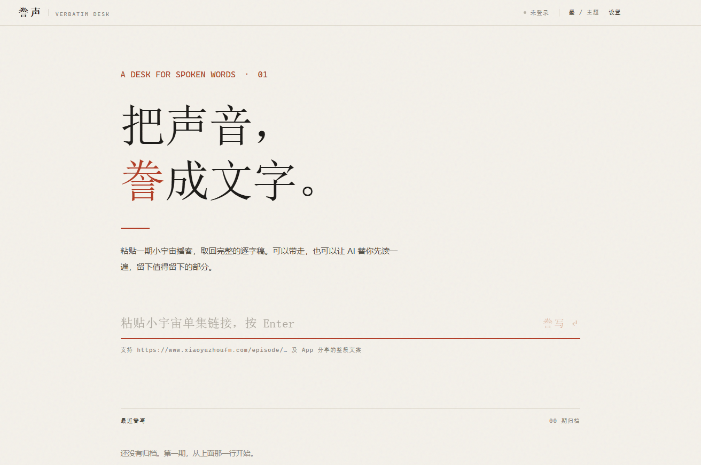
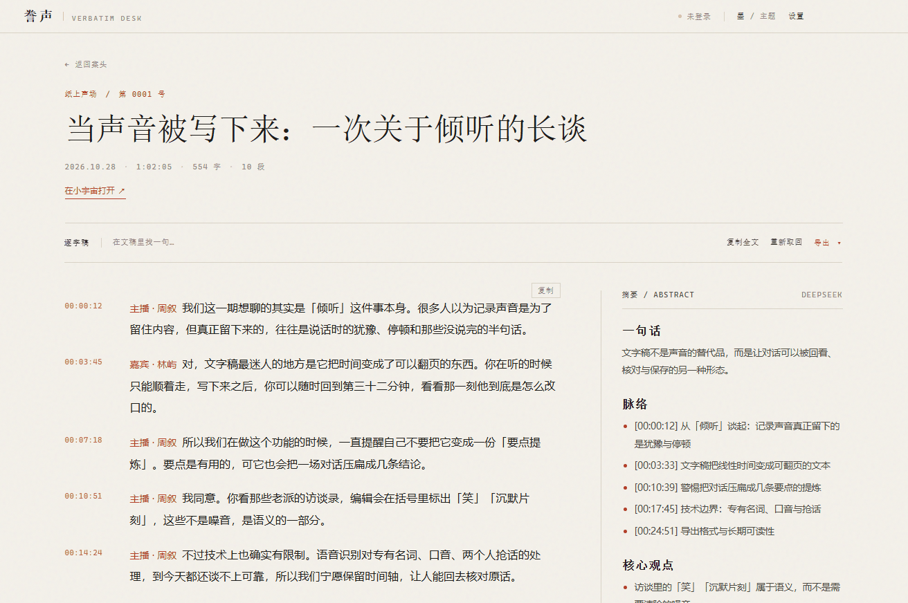

<div align="center">


<h1>誊声</h1>

**把声音，誊成文字。**

粘贴一期小宇宙播客的链接，取回完整逐字稿；再让编辑器读一遍，<br>
把脉络、观点和值得记下的原话留下来。

<br>


</div>

---



## 为什么做这个

播客最值钱的部分，往往不在标题和简介里，而在那些说着说着才冒出来的判断、犹豫和没说完的半句话。

音频不好检索，也不好引用。听完一期，两周后你只记得"好像聊过某件事"——具体怎么说的、在哪一分钟说的，全丢了。

**誊声**做一件很小的事：把一期节目变成一份可以翻、可以搜、可以带走的文字。不接管你的收听，也不替你做结论。

## 它能做到什么

**粘一条链接，回车。** 支持小宇宙单集链接、`eid`、App 分享出来的整段文案。**不需要登录小宇宙账号**——走的是单集页面的服务端渲染数据，不碰需要鉴权的接口。

**官方逐字稿优先。** 主播上传过文稿的节目，直接取回完整原文，带时间戳和说话人。没上传过会明确告诉你，不装作拿到了。

**归档在本地。** 取回的稿子存在你自己的机器上，下次打开直接读，不重复请求。支持全文搜索、点击跳转、按需重新取稿。

**五种去处。** 复制全文、复制单句、导出 TXT / Markdown / SRT 字幕 / 结构化 JSON。字幕能直接喂给剪辑软件。

**编辑式的摘要。** 填上 DeepSeek 的 key，长文稿会先分段通读，再落笔成稿。输出的不是"要点罗列"，而是纸刊编者按的体例：一句话、脉络、核心观点、值得记下的原话、留白。流式输出，随时可停。

**没有文稿的节目，还有两条后路。** 本地 faster-whisper（离线、免费、慢）或云端 SenseVoice（要 key、快、按分钟计费）。

**纸与墨两套主题。** 暖白纸色配朱红，或者全墨底色配暖白字。晚上读长稿不刺眼。

## 界面



左边逐字稿，右边摘要，顶部一条时间轴。段落按语义合并过，不是一句一行的字幕堆。

## 安装

### 从源码运行（推荐）

前置：**Node.js 18+**，以及能联网的环境（首次要装依赖）。

```bash
git clone https://github.com/hezhen20/pd2text.git
cd pd2text
npm install
npm run dev
```

开发模式带渲染层热更新，主进程改动会自动重启。

### 打包成安装包

```bash
npm run dist:win    # Windows → release/誊声-0.1.0-win-setup.exe（NSIS）
npm run dist:mac    # macOS  → release/誊声-0.1.0-mac.dmg
```

Windows 还会产出一份免安装版：`release/win-unpacked/誊声.exe`，双击即用。

### 第一次打开

1. 粘贴小宇宙单集链接（或 App 里"分享 → 复制链接"的整段文案），按回车
2. 有官方文稿 → 几秒后进入阅读页；没有 → 会提示改用语音转写
3. 想要摘要 → 右上角「设置」→ 填 DeepSeek API Key（[申请地址](https://platform.deepseek.com/)）。**key 留空也能正常取稿和导出**

## 数据放在哪

全部在你自己机器上，没有账号、没有云端同步、没有遥测。

| 内容 | Windows | macOS |
|---|---|---|
| 设置与 API Key | `%APPDATA%\tengsheng\data\settings.json` | `~/Library/Application Support/tengsheng/data/` |
| 文稿归档 | 同级 `data/records/` | 同左 |
| 音频缓存 | 同级 `audio/` | 同左 |
| 本地转写模型 | 同级 `whisper/` | 同左 |

API Key 用系统凭据加密后落盘（Windows DPAPI / macOS Keychain），不是明文。文件拷到别的机器上解不开，需要重填。音频缓存可以在设置里查看占用并清理。

## 注意事项

**关于内容。** 这是非官方工具，仅用于个人收听、存档和学习。文稿版权属于节目创作者，请勿用于商业转载或二次分发。请控制取稿频率，不要批量抓取——接口是公共的，被打挂了大家都用不了。

**关于取稿。** 小宇宙的接口不是公开 API，随时可能改版。取稿失败时先确认链接是否有效、节目是否已下架，再考虑是不是接口变了。另外，只有主播上传过文稿的节目才有官方逐字稿。

**关于 Windows 安装包。** 没有代码签名证书，所以首次运行会被 SmartScreen 拦一下：点「更多信息」→「仍要运行」。介意的话直接用 `npm run dev` 或免安装版。

**关于本地转写。** 需要本机已装 Python 3，并执行过 `pip install faster-whisper`。首次使用会下载模型权重（small 约 466 MB），建议先挂代理或选 tiny 试水。CPU 上跑长音频会比较慢，这是正常的。

**关于云端转写。** 默认接硅基流动（SiliconFlow）的 SenseVoiceSmall，需要自己去申请 key。云端结果不带时间戳，适合配合摘要校对，不适合做字幕。

**关于 key。** 别把自己的 `settings.json` 提交到任何仓库。本项目也不含任何内置密钥。

## 技术栈

Electron 36 + React 19 + TypeScript（`strict`）+ Vite 6，通过 `electron-vite` 组织主进程 / preload / 渲染层三层结构，`electron-builder` 出安装包。渲染进程跑在沙箱里，IPC 走 preload 白名单，摘要的 Markdown 经 DOMPurify 消毒。没有后端服务。

## 许可

[MIT](LICENSE) © 2026 hezhen20
